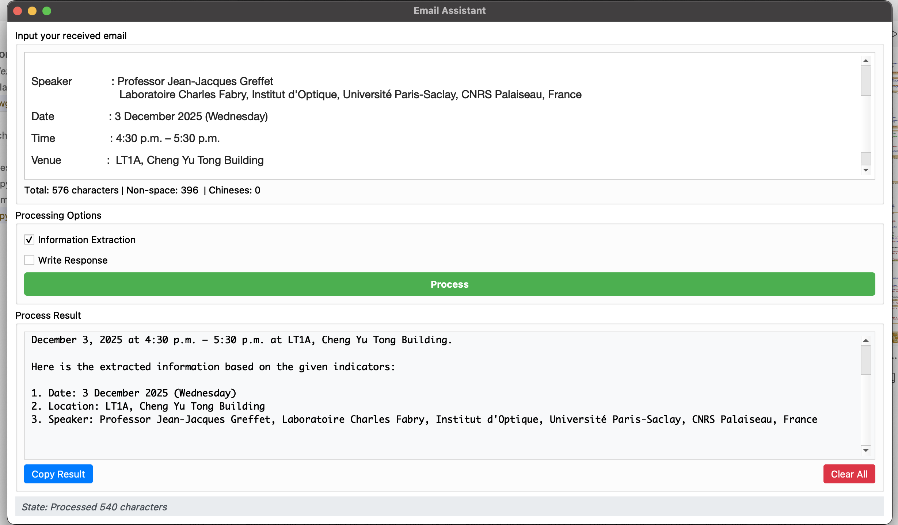

# Email Assistant

[Portfolio](https://bill02chen.github.io/chenyanrui-site/) · [GitHub](https://github.com/Bill02Chen)

An LLM workflow that reads an email, decides whether it is important, assigns
labels, and extracts the information a reader needs: dates, places, contacts and
deadlines.

**Key result:** an end-to-end, working workflow with a public web demo and a
recorded walkthrough. The repository holds the design report, the demo video and
an example screenshot; the application code lives on the platform used for the
demo, not in this repository.

## Problem

A campus mailbox mixes course notices, deadlines, administrative messages and
newsletters. Reading and sorting them by hand is slow, and important items are
easy to miss. A useful assistant must do more than classify: it must surface the
actionable fields and explain why an email matters.

## Approach

The assistant is a multi-agent workflow built on **ERNIE-Speed (10–15B)**, with a
parallel–serial pipeline.

```text
email
  │
  ├─ importance + label agent
  ├─ summary agent
  └─ extraction agent (date / place / contact / deadline)
        │
        └─ merge → structured output (labels, importance, key fields)
```

Design choices:

- **Parallel–serial workflow.** Independent sub-tasks run in parallel; the merge
  step runs after them.
- **Chain-of-Thought prompting.** Each agent is asked to reason before it
  produces its structured field.
- **Retrieval-augmented generation.** A campus knowledge base supplies course
  names, professors and context that the base model does not know.
- **Constrained output.** Prompts fix the output format so the result can be
  consumed by the GUI.
- **Two delivery forms.** One API version integrated with a GUI, and one web-chat
  workflow agent.

## Key result

- The workflow runs end to end: it labels an email, decides importance, writes a
  summary, and extracts key fields.
- The extracted fields cover the common campus cases: course name, professor,
  date, location, contact and deadline.
- The demo shows the complete flow from an email to the structured result.

No formal accuracy benchmark is committed. The report and the demo are the
evidence; claims about "near-human" quality should be read in that context.

## Evidence

[](Images/example1.png)

- [demonstration.mp4](demonstration.mp4) — recorded walkthrough of the workflow.
- [Images/example1.png](Images/example1.png) — example input and structured
  output.
- [email assistant.pdf](email%20assistant.pdf) — design report: motivation,
  agent roles, prompts and experiments.
- Web-chat demo: <https://appbuilder.baidu.com/s/ZLyPu0x2>

## What is in this repository

| Path | Contents |
| --- | --- |
| `Images/example1.png` | Example of the structured result |
| `demonstration.mp4` | Screen recording of the workflow |
| `email assistant.pdf` | Design and experiment report |
| `readme.md` | This document |

The implementation itself is not vendored here. The web-chat version is hosted on
Baidu AppBuilder; the GUI/API version used the same prompts and agent roles.

## Limitations and next steps

- The workflow was developed on a hosted platform, so the repository is not a
  self-contained runnable project.
- "Near-human" labelling is a qualitative observation from the design report, not
  a measured benchmark.
- Next: user-defined labels, and actions generated from the label and importance
  (for example, drafting a reply or creating a reminder).

## Media

The demo video is 18 MB; GitHub shows it as a downloadable file rather than an
inline player.
